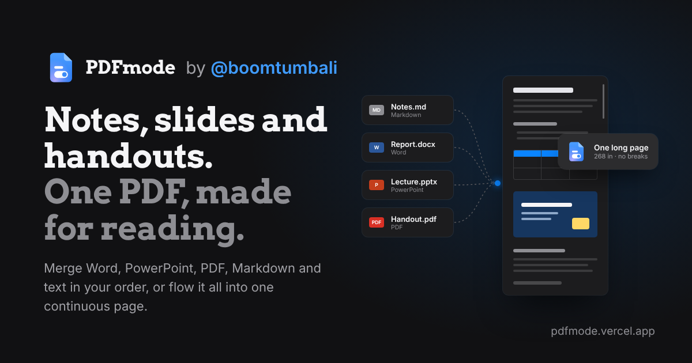

# PDFmode

**Notes, slides and handouts. One PDF, made for reading.**

PDFmode turns Markdown, Word, PowerPoint, PDF and plain-text files into one clean PDF. It can keep each file's own formatting and pages, merge several files in the order you choose, or flow everything into one continuous page you can scroll without a single page break. It's built for students reading reviewers, lecture slides and handouts on a phone, tablet or laptop.

🔗 **Live:** [pdfmode.vercel.app](https://pdfmode.vercel.app)
👤 **By:** [@boomtumbali](https://www.linkedin.com/in/boomtumbali)

The start page shows a short how-it-works film made in code: no video to download, it follows light and dark mode, scales to any screen, pauses when scrolled away, and stays still for people who turn off motion.

---

## What it does

- **Opens almost any class file:** Markdown (`.md`), Word (`.docx`), PowerPoint (`.pptx`), PDF, plain text (`.txt`) and web pages (`.html`). It detects the format from the file itself, so there's nothing to choose. Photos added next to documents become pages of their own; choosing only photos opens **Images to PDF**. Files PDFmode can't use (spreadsheets, ZIPs, audio…) get a clear message saying what to do instead.
- **Keeps the original formatting** of Word and PowerPoint files: fonts, sizes, colors, alignment, spacing, lists, tables, pictures, headers, footers and page numbers. Slides keep their backgrounds, shapes and layout.
- **Uses the real Google font when a file uses one** (Poppins, Montserrat, Roboto, Open Sans…), fetched once from the Fontsource mirror on jsDelivr; Microsoft fonts keep same-width stand-ins, and offline it falls back to the stand-ins.
- **Word letterheads and layout:** pictures, logos and text boxes placed in headers, footers and the page itself appear where Word puts them on every page; tab stops line up columns (signature blocks); table borders follow each cell's own settings.
- **Keeps the design of slides and documents:** background pictures, cropped and rotated photos, gradients, transparency, many shape types (stars, arrows, freeforms), lines, SmartArt and charts (drawn from the numbers saved in the file), plus cropped pictures and page colour in Word.
- **Edit text in Word and PowerPoint files:** change the words paragraph by paragraph, then export the PDF or download the edited .docx / .pptx. Pictures, colours and layout stay as they are.
- **Or switches to Reading style:** the text is reflowed in a reading typeface at your chosen size and page color, and speaker notes from slides are included.
- **Merges files in order.** Open several at once and they're combined in the order shown. Drag, or use the arrows, to reorder.
- **Three layouts:**
  - **Auto** (default): Word, PowerPoint and PDF keep their pages; Markdown and text become one continuous page.
  - **Continuous:** everything becomes one long page.
  - **Pages:** regular pages for everything.
- **Fits the device.** Auto width makes phone-width pages on phones, tablet width on tablets, and 8.5 in on computers. You can also pick a fixed size:

  | Size | Dimensions |
  | --- | --- |
  | Letter | 8.5 × 11 in |
  | Legal | 8.5 × 13 in (Philippine long bond) |
  | A4 | 8.27 × 11.69 in |
  | Tablet | 6 in wide |
  | Phone | 4.5 in wide |

- **Reading typefaces:** Slab (Arvo), Serif (Literata) and Sans (Atkinson Hyperlegible Next), plus **Original** for Office files.
- **Page colors and app appearance:**
  - **Page color:** Light, Sepia or Dark, applied to the PDF itself.
  - **Appearance:** System, Light or Dark (the default), for the app around the document.
- **Searchable output.** Text in the PDF is real, selectable text, and every file and heading becomes a bookmark.
- **Exact preview.** For Word, PowerPoint and merged files, the preview *is* the exported PDF.

## PDF tools

Twelve free tools, with no limits and nothing uploaded:

| Tool | What it does |
| --- | --- |
| Merge PDFs | Join 2 or more PDFs, Word files, slides or photos into one PDF, in your order |
| Compress PDF | Make a PDF smaller (Light, Recommended or Strong); text stays sharp |
| Split PDF | Cut a PDF into parts, or pull out the pages you need |
| Organize pages | Rotate, delete and reorder pages by dragging |
| Edit PDF | Change existing text, or add new text |
| Sign PDF | Draw, type or upload a signature, then place it on the page |
| Images to PDF | Turn photos and scans into one PDF |
| Convert PDF | Save pages as JPG or PNG images, or copy out the text (plain or Markdown) |
| Crop PDF | Trim the margins of one page or the whole PDF |
| Resize PDF | Change a PDF or Word file to A4, Letter, Legal or another size |
| Page numbers | Number every page in the corner you choose |
| Watermark | Stamp text like "DRAFT" on every page |

After every save, PDFmode confirms the file and suggests a useful next step. Picking one passes your new PDF straight into that tool, so there's no re-uploading.

## File names

Exports are named after the first (or only) file, then what was done to it: `Reviewer-made-by-pdfmode.vercel.app.pdf`, `abcd-merged-by-pdfmode.vercel.app.pdf`, `report-split-by-pdfmode.vercel.app.zip`.

## Privacy

Everything runs in your browser. Your files are **never uploaded** to a server. The app only downloads its own code libraries (from the jsDelivr CDN) when it loads.

## How to use

1. Go to [pdfmode.vercel.app](https://pdfmode.vercel.app).
2. Click **Choose files**, drop files anywhere on the page, or **Paste text**.
3. Adjust the settings if you like: Formatting, Layout, Width, Typeface, Text size, Page color.
4. Click **Export PDF**. The success screen confirms the file and offers a next step, like signing it or adding a watermark.

**Keyboard shortcuts:**
- `⌘O` / `Ctrl+O`: open files
- `⌘E` / `Ctrl+E` (or `⌘S` / `Ctrl+S`): export

## Good to know

- **Office fonts are replaced by free fonts with the same letter widths,** so lines break where they do in Office. For example, Calibri uses Carlito, Cambria uses Caladea, and Arial and Times New Roman use the Liberation fonts. Microsoft's own fonts are licensed and can't be bundled.
- **Some layouts are simplified:**
  - Word: columns, footnotes, SmartArt, and text wrapped around floating pictures.
  - PowerPoint: shadows, 3D effects, animations, and chart styling beyond basic column, bar, line, area and pie charts.
- **Older `.doc` and `.ppt` files aren't supported.** Save them as `.docx` / `.pptx` first.
- **Very long continuous pages** open fine in Chrome, Edge, Safari and most phone PDF viewers. Adobe Reader can't open single pages longer than 200 in; use **Pages** layout for Adobe Reader.
- **Maximum file size** is 40 MB per file.
- **Heavy files:** slide artwork is drawn as one layer per slide, big photos are resized to what a page needs, the exact preview only draws pages near the screen, and Word/PowerPoint text versions are made only when needed. If a Word or PowerPoint file still takes too long (over 45 seconds), PDFmode shows a light, text-only version you can export right away, with **Try full design** to try again with more time. In a merge, only the heavy file goes text-only; the others keep their design.
- **Offline:** files already open keep working. PDFmode shows a notice when the connection drops, since opening some kinds of files loads extra code.
- **Password-protected or restricted PDFs** can't be opened. PDFmode says so; remove the protection first.
- **Scanned PDFs** are pictures of pages, so their words can't be edited or copied. You can still sign, crop, number, split or merge them.
- **Sign PDF** places a picture of your signature. It isn't a certified digital signature.

## Run or host it yourself

PDFmode is a single self-contained `index.html` with no build step.

**Run locally:** open `index.html` in a browser.

**Host on Vercel:**
1. Put `index.html`, `og-image.png` and this `README.md` in a GitHub repository.
2. On [vercel.com](https://vercel.com), choose **Add New → Project**, import the repository, leave the **Framework Preset** as **Other**, and click **Deploy**.
3. Every commit to the repository redeploys the site automatically.

> If your site address isn't `pdfmode.vercel.app`, update the `og:url`, `og:image`, `twitter:image` and `canonical` tags in `index.html` so link previews work.

### Repository contents

| File | Purpose |
| --- | --- |
| `index.html` | The whole app: interface, conversion engine, PDF tools, embedded fonts and the GCash QR code (shown only when someone chooses to support) |
| `og-image.png` | Link-preview image for Messenger, Facebook, X and others |
| `README.md` | This file |

## Support

PDFmode is free for everyone, with no ads, no limits and no sign-up. If it saved you time, you can chip in any amount through GCash (or any InstaPay bank app) from the small **Support** link that appears after you save a file (or in the FAQ). It shows a short note first, and the GCash QR code only if you choose to chip in.

Follow the maker: [LinkedIn](https://www.linkedin.com/in/boomtumbali/) · [X](https://x.com/boomtumbali) · [GitHub](https://github.com/boomtumbali)

## Built with

| Purpose | Library |
| --- | --- |
| PDF layout | [pdfmake](https://github.com/bpampuch/pdfmake) |
| Merging, stitching and bookmarks | [pdf-lib](https://github.com/Hopding/pdf-lib) |
| Markdown | [marked](https://github.com/markedjs/marked) |
| Word → HTML (Reading style) | [mammoth.js](https://github.com/mwilliamson/mammoth.js) |
| HTML → Markdown | [Turndown](https://github.com/mixmark-io/turndown) + GFM plugin |
| Reading Office files | [JSZip](https://github.com/Stuk/jszip) |
| Exact PDF preview | [PDF.js](https://github.com/mozilla/pdf.js) |

**Fonts:** Arvo, Literata, Atkinson Hyperlegible Next, Inter (interface), JetBrains Mono, Carlito, Caladea, Liberation Sans and Serif, and DejaVu Sans (symbols). All are free, open-licensed fonts.

---

Made by [@boomtumbali](https://www.linkedin.com/in/boomtumbali).
